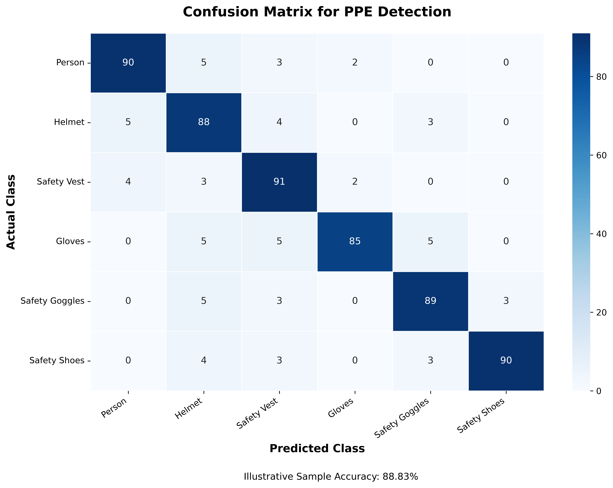

# SafeVision AI – AI-Powered Real-Time PPE Detection & Industrial Safety Monitoring



SafeVision AI is an end-to-end, enterprise-grade industrial safety surveillance system designed to detect workers, monitor Personal Protective Equipment (PPE) compliance in real time, identify safety hazards, manage incident records, trigger alarms, and dispatch automated consolidated email alerts using pretrained YOLO computer vision models and standard webcam hardware.

---

## Table of Contents

1. [Project Overview](#project-overview)
2. [Key Features](#key-features)
3. [System Architecture](#system-architecture)
4. [Technology Stack](#technology-stack)
5. [AI Detection Models & Weights](#ai-detection-models--weights)
6. [Prerequisites](#prerequisites)
7. [Environment Variable Configuration](#environment-variable-configuration)
8. [Backend Installation & Setup](#backend-installation--setup)
9. [Frontend Installation & Setup](#frontend-installation--setup)
10. [Gmail SMTP Alert Configuration](#gmail-smtp-alert-configuration)
11. [Running the Application](#running-the-application)
12. [Live Webcam Surveillance Operations](#live-webcam-surveillance-operations)
13. [Testing & Quality Assurance](#testing--quality-assurance)
14. [Repository Folder Structure](#repository-folder-structure)
15. [Privacy, Data Security & Local Storage](#privacy-data-security--local-storage)
16. [License & Acknowledgments](#license--acknowledgments)

---

## 1. Project Overview

Workplace safety compliance in construction, manufacturing, and heavy industrial environments requires continuous vigilance. SafeVision AI automates this monitoring by transforming any standard laptop webcam or RTSP/DirectShow industrial video stream into an intelligent safety auditor.

The application continuously tracks individual workers using **ByteTrack**, maps detected PPE equipment to the appropriate worker anatomy, confirms violations across a 5-second continuous threshold to eliminate false positives from transient occlusions, captures annotated evidence snapshots locally, triggers audio alarms, and sends consolidated email alerts to safety officers.

---

## 2. Key Features

- **Real-Time Video Surveillance:** High-framerate detection (15–30 FPS) with hardware-accelerated DirectShow capture on Windows and multi-platform OpenCV fallback.
- **ByteTrack Worker Tracking:** Persistent tracking IDs (`Worker #01`, `Worker #02`) across frames without requiring biometric or facial recognition databases.
- **Anatomical PPE Association:** Spatial IoU and region-based association mapping hardhats, goggles, and masks to head anchors, safety vests to torso anchors, and gloves/shoes to extremity anchors.
- **5-Second Violation Confirmation:** Filters out momentary occlusions or head turns; alarms and notifications activate only after non-compliance persists for 5 consecutive seconds.
- **Consolidated Worker Incidents:** Groups all missing PPE categories for a single worker into a single incident (`EVT-XXXX`), avoiding disjointed multi-email spam.
- **Camera-Bound Email Alert Engine:**
  - Strictly 0 automatic emails sent when camera monitoring is idle or stopped.
  - Exactly 1 initial consolidated email containing all missing PPE items and annotated image evidence upon confirmation.
  - Ongoing 5-minute reminder emails dispatched only while the incident remains active and the camera is live.
  - Instant cancellation of reminders upon compliance resolution or surveillance shutdown.
- **Real-Time Notification Center:** In-app notification drawer and dedicated audit page powered by WebSocket broadcasts and local JSON persistence.
- **Industrial PDF & CSV Reporting:** Generates audit-ready PDF reports with ReportLab and RFC 4180 CSV spreadsheets filtered by customizable time ranges (Today, Yesterday, Last 7 Days, Last 30 Days, All).
- **Zero Cloud Database Requirement:** Operates 100% locally using atomic filesystem JSON storage in `backend/storage/`.

---

## 3. System Architecture

```
                                  +------------------------------------+
                                  |        Webcam / Video Feed         |
                                  |      (DirectShow / OpenCV)         |
                                  +-----------------+------------------+
                                                    |
                                                    v
                                  +------------------------------------+
                                  |      Ultralytics YOLO Engine       |
                                  |  (Constructelligence / Vyra Model) |
                                  +-----------------+------------------+
                                                    |
                                                    v
                                  +------------------------------------+
                                  |        ByteTrack Tracker           |
                                  |  (Persistent Worker Track IDs)     |
                                  +-----------------+------------------+
                                                    |
                                                    v
                                  +------------------------------------+
                                  |    Spatial PPE Association &       |
                                  |   Compliance Evaluation Engine     |
                                  +-----------------+------------------+
                                                    |
                          +-------------------------+-------------------------+
                          |                                                   |
                          v                                                   v
          +-------------------------------+                   +-------------------------------+
          |    5-Second Violation Timer   |                   |     WebSocket Stream Server   |
          |       & Cooldown Filter       |                   |  (/ws/monitoring Live Video)  |
          +---------------+---------------+                   +-------------------------------+
                          |
                          v
          +-------------------------------+
          |   Consolidated Incident Event |
          |   (EVT-XXXX Multi-Category)   |
          +---------------+---------------+
                          |
             +------------+------------+----------------+
             |                         |                |
             v                         v                v
+------------------------+ +----------------------+ +------------------------+
| Local Evidence Service | | Audio Alarm Service  | | Camera-Bound Email Svc |
|  - Annotated JPEG      | |  - Audible Buzzer    | |  - 1 First Alert       |
|  - JSON Audit Record   | |  - Cooldown Silence  | |  - 5m Reminder Loops   |
+------------------------+ +----------------------+ |  - Camera-Stop Abort   |
                                                    +------------------------+
```

---

## 4. Technology Stack

### Backend
- **Python 3.10+ / 3.11+**
- **FastAPI**: Asynchronous high-performance REST API and WebSocket routing.
- **Uvicorn**: ASGI web server implementation.
- **Ultralytics YOLOv8**: Real-time object detection and ByteTrack tracking.
- **Hugging Face Hub**: Automatic model downloading and local caching.
- **OpenCV (`opencv-python`)**: Computer vision, video capture, and annotated frame rendering.
- **ReportLab**: Programmatic PDF safety audit generation.
- **Pydantic v2**: Strict schema validation.
- **python-dotenv**: Local environment variable management.

### Frontend
- **React 19 & TypeScript**: Responsive Single Page Application.
- **Vite 8**: Next-generation frontend tooling and bundler.
- **Material-UI (MUI v9) & Emotion**: Enterprise UI controls, modals, and drawers.
- **Tailwind CSS v4**: Modern utility-first styling.
- **Recharts**: Industrial telemetry and compliance charting.
- **Lucide React**: Clean, accessible vector icons.
- **Axios**: HTTP client with global interceptors.

---

## 5. AI Detection Models & Weights

SafeVision AI supports hot-swappable pretrained YOLO models directly from the Hugging Face Hub:

| Profile ID | Model Name | Repository & Weights | Classes Detected |
|---|---|---|---|
| `constructelligence` *(Default)* | Standard Site Hazards | `constructelligence/construction-site-safety-hazards`<br>`buildvision-hazards-v0.3.pt` | 11 classes: `person`, `hardhat`, `safety_vest`, `gloves`, `goggles`, `no-mask`, `safety_shoes`, `no-hardhat`, `no-safety_vest`, `no-gloves`, `no-goggles` |
| `vyra` | Extended Safety Model | `vyra/yolov8x-ppe`<br>`vyra-yolov8x-ppe.pt` | 10 classes: `person`, `hardhat`, `safety_vest`, `gloves`, `goggles`, `mask`, `no-hardhat`, `no-safety_vest`, `no-gloves`, `no-mask` *(No shoe class)* |

### Automatic Model Weights Download
Model weights are **not** bundled directly in the Git repository to keep the repository lightweight. When the backend initializes or switches profiles, the weights are automatically fetched using `huggingface_hub.hf_hub_download` and cached in your operating system's cache directory:
- **Windows:** `C:\Users\<User>\.cache\huggingface\hub\`
- **Linux / macOS:** `~/.cache/huggingface/hub/`

*Optional Manual Download:* If operating in an air-gapped environment, you can pre-download weights and pass local paths in `backend/app/services/model_registry.py`.

---

## 6. Prerequisites

- **OS:** Windows 10/11, Ubuntu 20.04+, or macOS (DirectShow optimized for Windows).
- **Python:** 3.10, 3.11, or 3.12 with `pip`.
- **Node.js:** 18.x, 20.x, or 22.x with `npm`.
- **Webcam:** Internal laptop webcam (device index 0) or USB camera.

---

## 7. Environment Variable Configuration

1. Copy the example configuration to `.env` at the project root:
   ```powershell
   Copy-Item .env.example .env
   ```
2. Open `.env` and configure your settings:
   ```env
   # Server Configuration
   HOST=127.0.0.1
   PORT=8000
   DEBUG=False

   # Default Alert Recipient
   EMAIL_RECIPIENT=safety_officer@example.com
   EMAIL_ENABLED=True

   # SMTP Configuration (Example: Gmail)
   SMTP_HOST=smtp.gmail.com
   SMTP_PORT=587
   SMTP_USE_TLS=True
   SMTP_USE_SSL=False

   # Authentication
   SMTP_SENDER_EMAIL=your_email@gmail.com
   SMTP_USERNAME=your_email@gmail.com
   SMTP_PASSWORD=your_16_char_app_password

   # Reminder Frequency (Minutes)
   EMAIL_REMINDER_INTERVAL_MINUTES=5
   ```

---

## 8. Backend Installation & Setup

From the root project directory:

```powershell
# 1. Create a Python virtual environment (if not already present)
python -m venv .venv

# 2. Activate the virtual environment
# Windows PowerShell:
.\.venv\Scripts\Activate.ps1
# Linux / macOS:
# source .venv/bin/activate

# 3. Upgrade pip
python -m pip install --upgrade pip

# 4. Install backend dependencies
pip install -r backend/requirements.txt
```

---

## 9. Frontend Installation & Setup

In a separate terminal:

```powershell
# 1. Navigate to the frontend directory
cd frontend

# 2. Install Node dependencies
npm install

# 3. Validate production build
npm run build
```

---

## 10. Gmail SMTP Alert Configuration

To enable automated email notifications using Google Gmail:

1. Enable **2-Step Verification** on your Google Account:
   - Go to [Google Account Security](https://myaccount.google.com/security).
2. Generate an **App Password**:
   - Navigate to [App Passwords](https://myaccount.google.com/apppasswords).
   - Enter `SafeVision AI` as the app name.
   - Copy the generated **16-character passcode** (e.g., `abcd efgh ijkl mnop`).
3. Set `SMTP_PASSWORD` in your `.env` or in the application **Settings -> Email Alerts** tab.
4. **Important Security Notice:** Never commit `.env` containing your App Password to Git.

---

## 11. Running the Application

### Start the Backend Server
```powershell
.\.venv\Scripts\Activate.ps1
cd backend
python -m uvicorn main:app --reload --host 127.0.0.1 --port 8000
```
- Interactive API Docs (Swagger): `http://127.0.0.1:8000/docs`
- Health Endpoint: `http://127.0.0.1:8000/api/health`

### Start the Frontend Interface
```powershell
cd frontend
npm run dev
```
- Web Application UI: `http://localhost:5173`

---

## 12. Live Webcam Surveillance Operations

1. Open `http://localhost:5173` in your browser.
2. Confirm the top status bar indicates **Monitoring: Idle**. The camera does not start automatically.
3. Click **Start Monitoring** on the **Live Monitoring** page (`/monitoring`).
4. The system will activate your webcam (DirectShow device index 0) and display the video stream with detection overlays.
5. Stand in front of the camera:
   - **Compliant:** Wearing approved PPE displays green boxes labeled `COMPLIANT`.
   - **Violation:** Missing PPE displays red bounding boxes. If non-compliance persists for **5.0 seconds**, an incident (`EVT-XXXX`) is confirmed, an audible buzzer sounds, a notification is logged, and an email alert with JPEG evidence is dispatched.
6. Click **Stop Monitoring** to deactivate the camera hardware and suppress all pending reminder emails.

---

## 13. Testing & Quality Assurance

SafeVision AI includes a comprehensive automated test suite. Run tests from the project root:

```powershell
# Run camera lifecycle & email suppression tests
.\.venv\Scripts\python.exe backend/test_camera_email_lifecycle.py

# Run email consolidation & reminder scheduler tests
.\.venv\Scripts\python.exe backend/test_email_service.py

# Run PDF & CSV report export tests
.\.venv\Scripts\python.exe backend/test_reports_api.py

# Run violation event lifecycle tests
.\.venv\Scripts\python.exe backend/test_violation_event.py

# Run alarm sound & cooldown tests
.\.venv\Scripts\python.exe backend/test_alarm_service.py

# Run REST API schema & endpoint tests
.\.venv\Scripts\python.exe backend/test_api.py

# Run thread safety & camera lifecycle shutdown tests
.\.venv\Scripts\python.exe backend/test_monitoring_controller.py
```

---

## 14. Repository Folder Structure

```
SafeVision-AI/
├── .env.example                     # Sanitized environment configuration template
├── .gitignore                       # Production Git exclusion rules
├── PPE_Confusion_Matrix.png         # Model architecture evaluation matrix
├── README.md                        # Master repository documentation
├── backend/
│   ├── main.py                      # FastAPI app entry point & lifespan events
│   ├── config.py                    # Server configuration constants
│   ├── requirements.txt             # Python dependency manifest
│   ├── app/
│   │   ├── api/                     # REST API routers (monitoring, violations, reports, etc.)
│   │   ├── services/                # Core engines (email, alarm, reports, notifications, etc.)
│   │   ├── detection/               # YOLO inference & spatial PPE association
│   │   └── tracking/                # ByteTrack multi-worker tracking logic
│   ├── models/
│   │   └── .gitkeep                 # Local model weights directory placeholder
│   └── storage/
│       ├── settings.example.json    # Default sanitized settings template
│       ├── evidence/
│       │   └── .gitkeep             # Local evidence directory placeholder
│       └── uploads/
│           └── .gitkeep             # Local uploads directory placeholder
├── frontend/
│   ├── package.json                 # Node package configuration
│   ├── package-lock.json            # Deterministic dependency lockfile
│   ├── vite.config.ts               # Vite build configuration
│   └── src/
│       ├── components/              # Reusable UI widgets, tables, and modals
│       ├── pages/                   # Main views (Overview, Monitoring, Workers, Reports, etc.)
│       ├── services/                # Axios backend API client services
│       └── types/                   # TypeScript interfaces & types
└── storage/
    ├── sample_construction.jpg      # Sample validation image for test suite
    ├── evidence/
    │   └── .gitkeep                 # Test evidence directory placeholder
    └── incidents/
        └── .gitkeep                 # Test incidents directory placeholder
```

---

## 15. Privacy, Data Security & Local Storage

- **Local Storage Model:** All video frames, audit logs, and settings reside strictly on the local machine under `backend/storage/`. No customer data or captured frames are transmitted to external servers (except outbound SMTP email alerts to the recipient you designate).
- **Credentials Protection:** Files containing live secrets (`.env`, `backend/storage/settings.json`, `email_history.json`, `notifications.json`, and `evidence/*.jpg`) are permanently excluded from Git tracking via `.gitignore`.
- **Facial Privacy:** SafeVision AI identifies workers solely via temporary tracking integers (`Worker #01`) assigned per session. It does not perform facial recognition, iris scanning, or biometric identification.

---

## 16. License & Acknowledgments

- Built using [Ultralytics YOLOv8](https://github.com/ultralytics/ultralytics).
- Pretrained weights provided via Hugging Face by [Constructelligence](https://huggingface.co/constructelligence) and [Vyra](https://huggingface.co/vyra).
- Open source under the MIT License.

